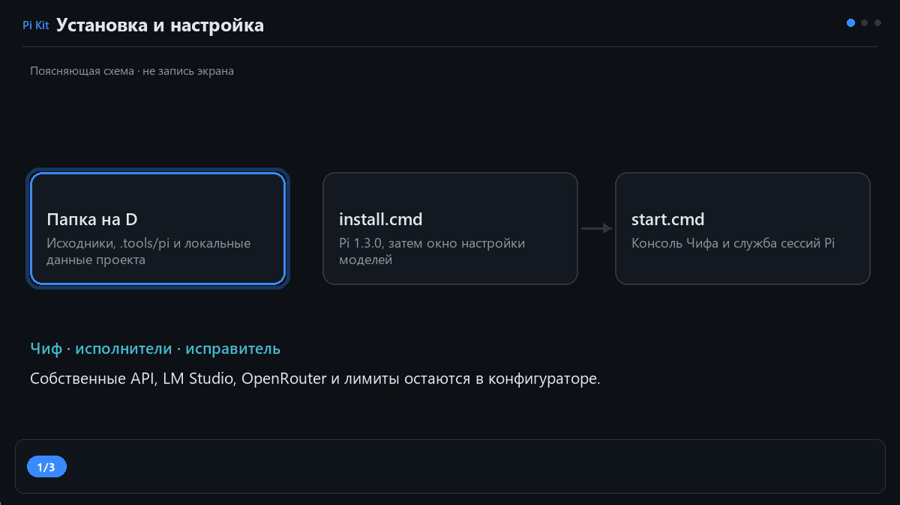
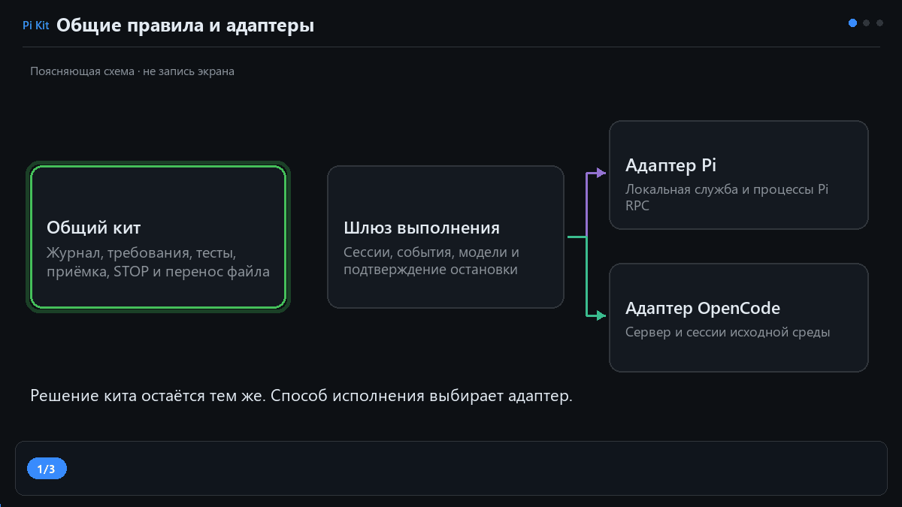
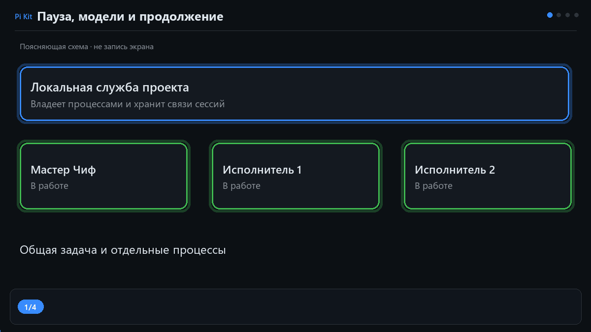
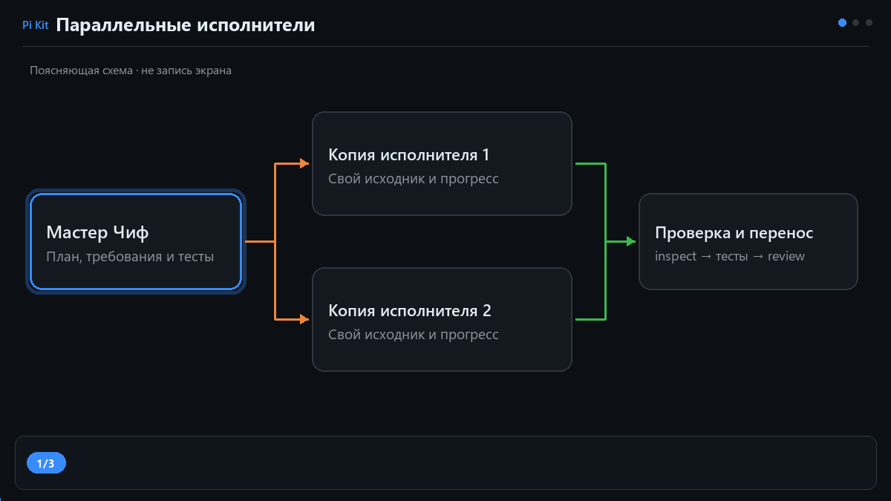
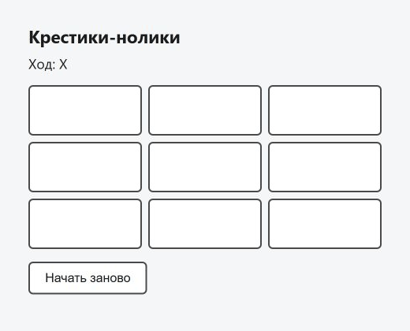

# Pi Agent Kit

[English](README.en.md) · [Быстрый старт](docs/user/PI_QUICKSTART.ru.md) · [Как устроена адаптация](docs/kit/PI_ADAPTERS.ru.md) · [Все руководства](docs/README.md)

Кит организует работу команды агентов поверх Pi. Мастер Чиф готовит план, требования,
заготовки и тесты. Исполнители реализуют небольшие части в отдельных копиях проекта.
Чиф проверяет каждую попытку и переносит принятый файл. Если требуется исправление,
контроллер передаёт работу Bug Fixer в пределах заданного запаса попыток.

Это отдельная адаптация [opencode-environmental-tune](https://github.com/polar-byter/opencode-environmental-tune)
от коммита `03c128d7fd46e4b1346d37c0521b4b6cb4ea3361`.
История исходного проекта и лицензия MIT сохранены. Подробнее — [SOURCE.md](SOURCE.md).

## Установка на Windows

Помести репозиторий на диск с достаточным свободным местом, например
`D:\Projects\ActiveProjects\AIProjects\pi-agent-kit`. Запусти **install.cmd**.
В мастере выбери отдельную папку своего проекта на D. Установщик размещает Pi
рядом с шаблоном, копирует кит в выбранный проект и открывает конфигуратор.
Выбери модели трёх ролей, сохрани выбор и подготовь Pi. Затем запусти
**start.cmd из папки своего проекта** и напиши своё ТЗ прямо в штатном интерфейсе Pi. Файл TASK.md необязателен.

Pi закреплён на версии **1.3.0**. Его пакеты лежат в `.tools/pi` внутри папки шаблона.
Установленные проекты используют эту общую локальную установку через ссылку
в `.pi/installation.json`; папку шаблона после установки следует сохранить.
OpenCode Desktop для этого варианта запуска не нужен. Общий системный Python
и глобальная установка npm не используются для установки Pi.
Размещение Python и требования к Node описаны в [быстром старте](docs/user/PI_QUICKSTART.ru.md).

Четыре GIF установки, адаптеров, сессий и параллельной работы — поясняющие схемы. Они показывают последовательность действий,
а не запись экрана или доказательство успешного запуска модели.

## Модели и лимиты

У Чифа, исполнителей и исправителя могут быть разные подключения. Конфигуратор
сохраняет собственные API, витрину OpenRouter и выбор загруженного экземпляра
LM Studio для исполнителей. Здесь же задаются число параллельных исполнителей,
предел времени, шагов и повторений, а также запас попыток исправителя.

Выбор пользователя хранится в `.pi/kit-models.json`. Подготовленная конфигурация —
в `.pi/kit-runtime.json`. Ключи не записываются в эти JSON: сохраняются имена
переменных окружения. Старый выбор из каталога OpenCode требует явного выбора
подключения Pi; доступность модели не переносится вместе с её названием.

Для встроенного провайдера Pi сначала запусти `start.cmd --authenticate`
из своего проекта: `/login` → подключение провайдера → `/quit`.
Затем в `start.cmd --configure` обнови каталог и выбери модели.
Глобальный вход Pi не используется: учётные данные этого проекта находятся
в исключённом из Git `.pi/agent/auth.json`. Собственный API по-прежнему
настраивается через конфигуратор. [Подробнее о подключении](docs/user/PI_QUICKSTART.ru.md#выбор-подключения).

«Проверить связь» проверяет доступность API. Чтобы проверить работу инструментов
модели, нужен отдельный небольшой запуск задачи.

## Общие правила и адаптер

Журнал, требования, снимки файлов, проверки приёмки, тесты, бюджеты попыток,
STOP и перенос принятого файла остаются в общей части кита.
Адаптер Pi отвечает за создание сессии, передачу задания, события, модели,
историю, расход и подтверждение остановки.

Чиф и каждый исполнитель работают через локальную службу проекта. Она владеет
процессами Pi RPC и сохраняет связи между задачей, сессиями и попытками.
Дашборд обращается к той же службе. Закрытие браузера не останавливает агентов.
История сессии позволяет восстановить разговор после остановки службы;
прерванное выполнение не считается продолжающимся само по себе.

## Пауза и продолжение

Пауза относится ко всей задаче: служба останавливает Чифа и исполнителей,
очищает очередь и проверяет остановку. На паузе можно изменить модели в
конфигураторе и подготовить настройки заново. Продолжение использует прежнюю
задачу и её историю. Принятые результаты и частичные изменения проверяются
правилами контроллера.

В Pi доступны `/kit-pause`, `/kit-resume`, `/kit-cancel`, `/kit-status` и `/kit-dashboard`.
Команды `/new`, `/resume` и редактор остаются штатными командами Pi. `/quit` приостанавливает незавершённую задачу и закрывает терминал.
Для завершения работы службы запусти `start.cmd --stop-service`.
Команды и последствия остановки подробно разобраны в
[руководстве по сессиям](docs/user/PI_QUICKSTART.ru.md#пауза-продолжение-и-закрытие).

## Как изучать код

Начни с [карты модулей](docs/kit/PI_ADAPTERS.ru.md#порядок-чтения).
Она связывает действие пользователя с конкретным модулем и объясняет, где
заканчиваются правила кита и начинается интеграция с Pi.
Потом можно проследить одну попытку: поручение → исполнение → остановка →
`inspect` → тесты → `review` → перенос файла.
Этот путь разобран по конкретным функциям в
[пошаговом чтении кода](docs/kit/PI_CODE_WALKTHROUGH.ru.md).

Унаследованные руководства OpenCode сохранены как материал об исходной версии.
Их команды запуска и описания сессий не заменяют инструкции Pi.
Результаты проверок исходного проекта также не подтверждают адаптацию:
текущий статус смотри в [документе проверок](docs/kit/PI_VALIDATION.ru.md).

Источники анимаций и пересборка находятся в [readme_gif](readme_gif/README.md).

## Живой проверочный проект

[Крестики-нолики](examples/tic-tac-toe/README.md) получены в настоящем прогоне
через OpenRouter: DeepSeek — архитектор и Bug Fixer, MiMo — исполнители.
Игра имеет 20 тестов и запускается без внешних библиотек.
[Отчёт прогона](docs/kit/PI_LIVE_SCENARIO.ru.md) описывает найденные ошибки,
двух одновременных исполнителей, паузу, восстановление, отмену и удаление.

Ниже — запись настоящего браузера с работающей игрой:

## Чистый прогон системы с Чифом

В новом проекте Чиф получил только требования к игре, сам запустил двух исполнителей,
проверил и интегрировал результаты, выполнил обзор интерфейса и записал finish.
Ведущий наблюдал за разработкой без подсказок и ручной приёмки. Найденные
дефекты кита и границы проверки разобраны в [отчёте](docs/kit/PI_CLEAN_RUN.ru.md).

## Нативный терминал Pi

Обычный start.cmd открывает официальный InteractiveMode Pi с многострочным редактором.
[Устройство и проверки входа](docs/kit/PI_NATIVE_TERMINAL.ru.md). Для уже установленной
копии доступно `install.cmd --update "D:\папка-проекта"` из папки обновлённого шаблона.
