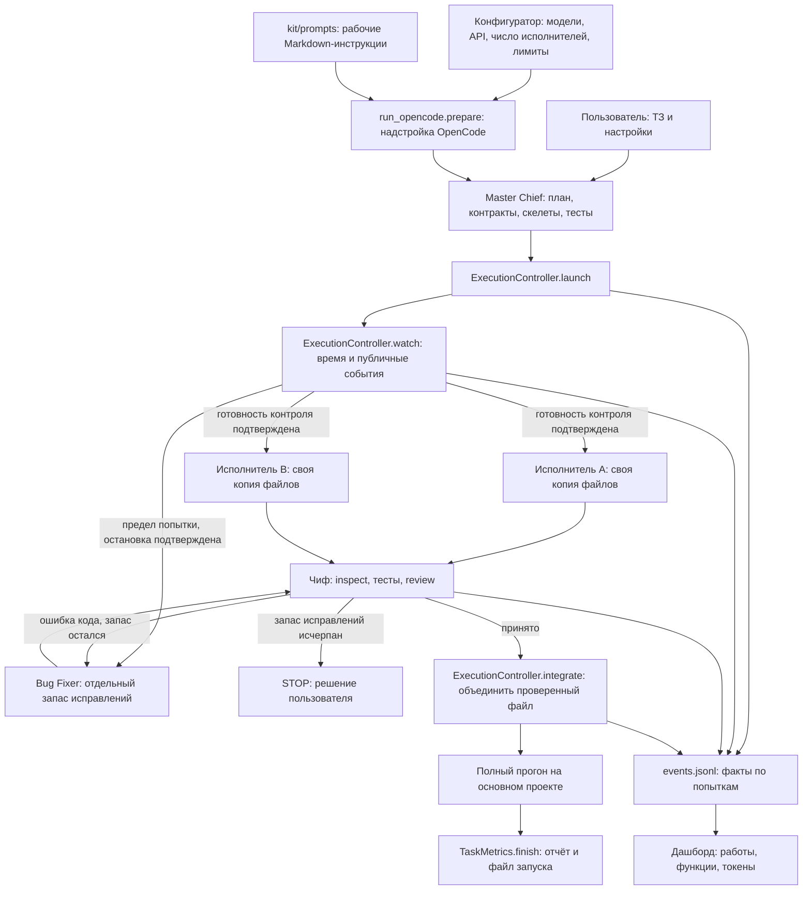
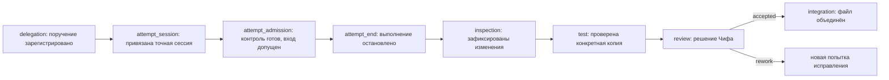

> Материал исходной версии OpenCode. Сохранён для изучения общего кита и истории.
> Для текущей адаптации используй [быстрый старт Pi](../user/PI_QUICKSTART.ru.md)
> и [карту адаптеров](../kit/PI_ADAPTERS.ru.md). Команды OpenCode здесь не являются командами Pi.

# Исполнители, исправитель и метрики: как это устроено

Это руководство для первого знакомства с кодом. Начните со схемы, затем
проследите один пример. Имена модулей и методов ниже совпадают с исходниками.

## Сначала пять понятий

**Задача** — весь запрос пользователя, например приложение бюджета. У неё один
`task ID`, план, журнал событий и итоговый отчёт.

**Work item, или поручение** — небольшая связная часть задачи: один файл с классом
или функциями. Например, `budget` и файл `app/budget.py`.

**Попытка, или attempt** — один запуск модели для этого поручения. Если результат
отклонён и файл передан исправителю, это новая попытка того же поручения.

**Worker, или участник** — конкретный исполнитель или Bug Fixer этой попытки. Его `worker_id`
отличает его от соседнего исполнителя с такой же моделью. **Session ID** — точный
идентификатор соответствующей сессии OpenCode, откуда берутся фактические модели
и расход. Название модели не заменяет идентификатор сессии.

**Контракт** — договорённость между частями программы: какие функции доступны,
что принимают и возвращают, какие ошибки выдают. В C/C++ это могут быть `.h`/`.hpp`,
в Java — интерфейсы и общие классы, в веб-приложении — форматы API и схема БД.
Чиф фиксирует только применимые договорённости: Python-проекту не нужен `.h`.

## Общая схема

Чиф принимает решения о задаче. Контроллер — обычный Python-код, который
обеспечивает технические ограничения. Это не ещё одна ИИ-модель.

## Настройка моделей и параллельности

Окно открывает `kit/configurator/desktop.py`, класс `DesktopConfigurator`.
В нём четыре раздела: Чиф, исполнители, исправитель и витрина OpenRouter.
На небольшом экране кнопки ролей размещаются в два ряда; в витрине они становятся
компактнее, чтобы не вытеснять таблицу. При первом запуске язык выбирается из
окружения (EN/RU), ручной выбор сохраняется и имеет приоритет.
Подробнее: [локализация](LOCALIZATION.ru.md).

В разделе исполнителей задаются число одновременных попыток, шаги, секунды
и число одинаковых действий без прогресса. У исправителя свои шаги и секунды.

| Настройка | Значение по умолчанию | Смысл |
| --- | --- | --- |
| `maxExecutors` | 2 | Максимум одновременно зарезервированных рабочих попыток, от 1 до 8 |
| `maxSteps` | 24 | Бюджет шагов обычного исполнителя |
| `maxSeconds` | 600 | Бюджет времени обычной попытки |
| `maxRepeatedActions` | 3 | Предел одинаковых публичных действий с одинаковым результатом без изменения файла |
| `fixerMaxSteps` | 32 | Бюджет шагов исправителя |
| `fixerMaxSeconds` | 600 | Бюджет времени исправителя |
| `executorMaxAttempts` | 3 | Неудачные попытки кода исполнителя на модуль |
| `fixerMaxAttempts` | 6 | Неудачные исправления Bug Fixer на модуль |
| `maxAttempts` | 9 | Общий предел ошибок кода на модуль; API/setup не учитываются |

Количество — верхняя граница, а не требование постоянно занимать все места.
Два независимых модуля можно поручить параллельно. Модуль, использующий ещё
непринятый интерфейс другого модуля, ждёт его приёмки и объединения.
Лимиты аккаунта API остаются общими для всех сессий.

По умолчанию разрешены два исполнителя. Если готова только одна часть, она
запускается одна и может обойтись без общих контрактов; попытки, которые идут
одновременно, обязаны назвать контракты все. Проект без сохранённого числа
исполнителей получает 2. Значение 1, выбранное в конфигураторе, сохраняется явно
и оставляет прежний последовательный протокол.

По выбранным пользователем настройкам шаблон использует:

- Чиф и исправитель: `opencode/deepseek-v4.1-flash-free`;
- исполнители: `opencode/mimo-v2.6-flash-free`.

Это выбранные модели, а не доказательство их фактического участия. Реальную
модель и токены дашборд получает из публичных метаданных сообщений OpenCode.
Наличие модели в каталоге и загрузка конфигурации не доказывают успешную генерацию.

Выбор конкретной папки хранится в `.opencode/kit-models.json`.
Старые файлы с `masterChief` и `executors` остаются читаемыми. Необязательная секция
`execution` содержит лимиты, `bugFixer` — отдельную модель или собственный API.
Отсутствующий исправитель в старом сохранённом выборе остаётся выключенным.
Для новой копии шаблона без сохранённого выбора используются настройки шаблона.

Сам ключ остаётся в пользовательской переменной Windows. В JSON записывается
только её имя, например `OCK_BUG_FIXER_API_KEY`. Роли могут разделять одну
переменную или использовать разные ключи. Проверка связи не запускает генерацию.

## Как значения из окна доходят до OpenCode

| Файл и функция | Зачем нужны |
| --- | --- |
| `configurator/app.py:form_to_choices` | Превращает строки полей окна в структуру настроек |
| `configurator/app.py:choices_to_form` | Возвращает сохранённый выбор в поля без потери лимитов исправителя |
| `configurator/workflow.py:validate` | Проверяет все роли, ключи и числа до записи |
| `configurator/workflow.py:save` | Сохраняет проверенный выбор и только введённые активные ключи |
| `run_opencode.py:load_choices` | Читает выбор; проверяет источники моделей и лимиты |
| `run_opencode.py:prepare` | Создаёт локальную надстройку `.opencode/opencode.jsonc` с моделями, промптами и шагами |

**Надстройка, или overlay**, — дополнительные настройки поверх основного конфига.
Это генерируемый файл; править его вручную не нужно. Сохранение формы не меняет
модель уже выполняющейся сессии. Подготовка предназначена для следующего запуска.
При первом запуске контроллер сохраняет выбранные модели и лимиты в
`.metrics/<task>/execution-settings.json`. Это зафиксированный профиль задачи,
без самих ключей. Изменение черновика в окне не меняет текущую задачу.
Подготовка новой надстройки блокируется, пока изолированная работа не завершена
или не отменена, чтобы не заменить настройки API у уже работающей задачи.

## Один пример от начала до конца

Чиф готовит `app/budget.py` и `app/routine.py`, фиксирует схему SQLite и публичные
интерфейсы. После готовности общих зависимостей поручения могут идти параллельно.

1. Чиф начинает один журнал с фактическим ID корневой сессии. Публикует архитектуру
   и перечень функций. Записывает требования каждого поручения.
2. Вызывает контроллер для `budget`. Метод `launch` копирует исходники в
   `.metrics/<task>/workspaces/<уникальный-каталог>/`, регистрирует попытку и создаёт
   дочернюю сессию OpenCode с выбранной моделью.
3. Разрешения этой сессии запрещают shell, новые подагенты и изменения основного
   проекта. Разрешена запись одного конкретного файла копии и своего progress JSON.
4. Команда запускает отдельный процесс `watch` и ждёт подтверждения его готовности.
   Только затем отправляет вход модели и записывает `attempt_admission`.
   Если контроль не запустился, задание не отправляется. Поэтому ещё работающая
   модель ограничена и тогда, когда она пока не вернула ответ Чифу.
5. Чиф может запустить `routine` таким же способом. Его каталог, session ID,
   attempt ID и progress-файл отличаются.
6. Когда бюджет вернулся, контроллер подтверждает остановку и записывает
   `attempt_end`. Чиф вызывает `inspect`, читает реализацию и запускает тесты
   с `--attempt <точный-ID> --scope budget`. Они выполняются в копии бюджета.
7. Чиф фиксирует `review accepted` с доказательствами по каждому требованию.
   Затем `integrate` переносит один проверенный файл в основной проект.
8. Распорядок проходит тот же путь. Приёмка бюджета не засчитывает его тесты.
9. После объединения всех модулей идёт этап улучшения UI/UX: Чиф запускает
   приложение и проходит основные сценарии интерактивно — формы, сохранение,
   ошибки ввода. Согласованные UX/UI-правки проходят отдельную проверку. Итог
   записывается командой `task_metrics.py ux-review` (`TaskMetrics.ux_review`):
   `--checks` со списком сценариев, `--skipped "причина"` или `--not-applicable
   "причина"`. `TaskMetrics.finish` не закроет задачу с `--track-delegations` без
   этой записи; отчёт (`render`) и дашборд (`delivery.completion`) показывают итог.
   Затем Чиф запускает полный набор тестов в основном проекте и завершает задачу.
   Наличие кода не доказывает качество интерфейса.

Пользователь эти команды вручную не выполняет: они записаны в рабочем промпте
Чифа и `AGENTS.md`. Здесь они описаны для понимания и диагностики.

Новый контроллер работает с общей службой OpenCode Desktop и точным ID корневой
сессии этого проекта. Частный режим `--standalone` к ней автоматически не
перепривязывается. В нём остаётся прежний последовательный протокол; новый
контроль во время вызова ему не приписывается. Для изолированных исполнителей
нужно начать задачу в общей службе Desktop.

## Почему файлы исполнителей не конфликтуют

**Снимок, или snapshot**, — перечень файлов и их контрольных сумм. Контрольная
сумма меняется, если меняется содержимое. `delegation_guard.take_project_snapshot` учитывает
исходники, включая новые и игнорируемые Git файлы, но исключает генерируемые папки.
Ссылки и junction не обходятся автоматически.

Контроллер использует обычные независимые копии снимка. Git worktree для этого
не требуется; пользовательские изменения не коммитятся. Файлы `.env*`, `auth.json`,
`credentials.json`, файл `.git` и папки `.aws`, `.ssh`, `.codex`, `.agents`
в копию не переносятся. Исходники не хранят в исключённых
папках `node_modules`, `build`, `dist` и подобных.

Один исходный файл нельзя назначить двум активным поручениям. Даже разные файлы
могут зависеть от общего `.h` или интерфейса: поэтому явно переданные контрактные
файлы тоже фиксируются контрольными суммами.

`integrate` проверяет, что исходный файл и контракты не изменились в основном
проекте, а рабочая копия соответствует принятому зелёному прогону. При конфликте
он отказывается перезаписывать файл. Чиф должен подготовить свежую попытку с
актуальным контрактом. Если запись события объединения не удалась, файл
восстанавливается: журнал не должен утверждать другое состояние кода.

## Если модель зациклилась до ответа Чифу

**Watchdog** — сторожевой механизм. В этом проекте это метод `watch` контроллера,
а не обещание в промпте и не автоматическое наблюдение этого чата.

Он ограничивает попытку временем и публичными шагами. Повтор сравнивается по
вызову инструмента, его аргументам и результату. Уже прочитанные события не
считаются повторно. Приватные рассуждения не анализируются и не передаются.

Если один запрос модели долго генерирует ответ, без вызовов инструментов,
логическое зацикливание надёжно определить нельзя. Срабатывает бюджет времени.
Даже зависшее чтение состояния не отменяет этот бюджет. После предела контроллер
запрашивает прерывание сессии, очищает очередь и проверяет отсутствие активности.
Само прерывание и подтверждение занимают дополнительное время. Остановка на
клиенте не гарантирует немедленного прекращения вычислений у внешнего провайдера.

| Причина | Следующее действие |
| --- | --- |
| Проверенная ошибка реализации | Чиф отклоняет попытку и может передать тому же поручению выбранного исправителя |
| Предел шагов, повторов или времени | Контроллер подтверждает остановку и передаёт Bug Fixer; последующие исправления остаются у него в пределах запаса |
| `429`, ошибка API или тестовой среды | Блокировка и диагностика; автоматической смены модели нет |
| Пользовательская пауза/отмена или общий STOP | Остановка; исправитель не запускается |
| Не удалось подтвердить остановку | Замена блокируется |
| Исправитель тоже не справился | Остановка и решение пользователя; обратной передачи исполнителю нет |

Передача называется **эскалацией**: сложная работа переходит другой роли.
Исправитель получает существующую реализацию, неизменённые требования и публичные
ошибки тестов, если они были. Он не меняет контракт и не ослабляет тесты.
Здесь нет гарантии, что конкретная модель всегда сильнее: это выбор пользователя.

## Как читать журнал и дашборд

`events.jsonl` — текстовый журнал, в каждой строке один JSON-объект с фактом.
Новые события добавляются; старые строки не переписываются.

`implemented` означает «исполнитель сообщил о реализации», `accepted` —
«Чиф проверил и принял», `integrated` — «проверенный файл перенесён в основной
проект». Это три разных факта. Финальная готовность требует общего зелёного прогона.

`tracking.work_items` собирает поручения и историю попыток. `function_progress`
показывает функции и несколько текущих исполнителей. Старые записи без worker ID
остаются старыми записями: им не приписывается вымышленный номер исполнителя.

Токены берёт `TaskMetrics.parse_exports`: уникальность определяется парой
`(session ID, message ID)`. Повторный экспорт не увеличивает расход, а одинаковый
ID сообщения в другой сессии не теряется. Общий итог по моделям и детализация
попыток — разные представления тех же данных, их нельзя складывать друг с другом.
Стоимость показывается только при наличии числового `cost` в метаданных;
тариф из витрины не выдаётся за фактический счёт. Отсутствие данных не равно нулю.
Это учётная стоимость OpenCode, а не сверенный счёт провайдера. Валюта `cost` —
USD по [официальной справке OpenCode](https://opencode.ai/v2/docs/cli/acp/).

`observations.attach_models` связывает новые попытки с точным session ID,
а не угадывает по совпавшему времени. В дашборде видны роль, worker ID, фактическая
модель, причина остановки, длительность с ожиданием, тесты и отдельный расход.

## Карта исходников

Все пути в таблице начинаются от корня проекта.

| Модуль / класс | Основные функции | Назначение |
| --- | --- | --- |
| `kit/execution_policy.py` | `normalize_policy`, `limit_reason`, `next_action` | Чистые правила: проверить лимиты и выбрать разрешённое действие; никаких API и окон |
| `kit/execution_controller.py:worker_permissions` | Функция построения правил | Переводит разрешённые файлы в относительные ресурсы OpenCode; сохраняет общий запрет |
| `kit/execution_controller.py:ExecutionController` | `settings`, `launch`, `verify_permissions`, `binding`, `spawn_watch`, `observe`, `watch`, `stop`, `integrate` | Зафиксированный профиль задачи, проверка реальных прав до модели, жизненный цикл попытки и объединение |
| `kit/task_metrics.py:TaskMetrics` | `delegate`, `attempt_root`, `inspect`, `test`, `review`, `finish` | Команды задачи и CLI: проверить правила и дописать событие в журнал |
| `kit/journal.py:TaskJournal` | `read`, `append`, `lock`, `task_dir`, `corrected_events` | Журнал событий `events.jsonl`: только дописывание, один писатель на задачу |
| `kit/loop_guards.py` | `limit_breach`, `is_halted`, `DEFAULT_LIMITS` | Защитные остановки: когда задачу нужно остановить и спросить пользователя |
| `kit/suite_runner.py` | `run_command`, `parse_unittest`, `parse_junit_files`, `run_category` | Запуск тестовой команды и разбор результата |
| `kit/usage_report.py` | `collect_exports`, `parse_exports`, `render` | Расход токенов из выгрузок OpenCode и отчёт `report.md` |
| `kit/delegation_guard.py` | `take_project_snapshot`, `compare_project_snapshots`, `review_checks` | Снимки файлов и формальная полнота доказательств ревью |
| `kit/dashboard/session_control.py:SessionControl` | `call`, `active`, `interrupt`, `clear_inbox`, `tree` | Общение с установленным OpenCode и проверка семьи сессий |
| `kit/task_control_state.py` | `blocking_reason` | Запрет новых действий при пользовательской паузе/отмене |
| `kit/dashboard/tracking.py` | `work_items`, `function_progress` | Проекции журнала для интерфейса; проекция — удобное представление исходных фактов |
| `kit/dashboard/observations.py` | `SessionReader`, `attach_models` | Публичные данные сессий и точная привязка моделей/расхода |
| `kit/dashboard/runtime.py` | `task_view` | Собрать данные задачи для браузера |
| `kit/dashboard/static/runtime.html` | `renderLive`, отрисовка work items | Показать одновременно работающих участников и детали попыток |
| `kit/configurator/desktop.py:DesktopConfigurator` | `build_role`, `layout_navigation`, `check_connection` | Окно моделей, лимитов, источников API и проверка связи |
| `kit/run_opencode.py` | `load_choices`, `prepare` | Проверка настроек и подготовка надстройки OpenCode |

## Промпты и пояснения

Четыре рабочих документа находятся в `kit/prompts`. Их заголовки отделяют роль,
вход, границы, прогресс, остановку и результат. Человеческая инструкция:
[kit/prompts/README.ru.md](../../kit/prompts/README.ru.md).

README не добавляется к системному промпту. HTML-комментарии внутри рабочего
текста модель может прочитать. Комментарии `//` вне строк JSONC не входят в
значение `system`, но сам конфиг остаётся читаемым файлом. Секреты сюда не пишут.

## Что подтверждают проверки

Тесты `test_execution_policy`, `test_parallel_execution` и
`test_execution_configuration` проверяют лимиты, двух независимых исполнителей,
приёмку и конфликты, остановку зависшей попытки, передачу и ограниченные повторы, отсутствие
платного fallback на 429, сохранность настроек и разделение расхода.
Тесты окон используют настоящий Tk и имитацию сетевых сервисов.

Отдельно установленный OpenCode проверяет загруженные модели, режимы агентов,
полные канонические промпты и пределы шагов через свой публичный API.
Итоговый прогон 16.10.2026: **558 тестов, OK, без ошибок и пропусков**.
Проверка настоящего запуска без генерации подтвердила создание дочерней сессии,
разрешения, изоляцию, готовность сторожевого процесса до допуска задания и его
завершение при отказе допуска. Число запросов генерации в этой проверке — ноль.
Это не запуск двух реальных моделей на продукте. Такой эксперимент проводится
отдельно на новом ТЗ; его результат нельзя выводить из автоматических тестов.

## Как считаются повторные исправления

`execution_policy.attempt_counts()` связывает ревью с конкретным поручением
(`delegation_id`) и считает ошибки по модулю и роли. Прерывания API и настройки
исключаются по `attempt_end`, включая старые журналы, где они записаны как rework.
`budget_reason()` проверяет общий предел и запас выбранной роли.
`TaskMetrics.review()` сохраняет ревью и при необходимости STOP;
`ExecutionController.watch()` проверяет STOP до запуска продолжения, поэтому
достигнутый предел возвращается как результат, а не как падение сторожа.

`ExecutionController.launch()` заранее создаёт пустой progress JSON и передаёт
точные пути отдельными строками. Рабочие каталоги названы по ID участника.
Исполнитель читает исходник, контракты и тесты внутри своей копии; тесты запускать
и менять нельзя. Основной проект и соседние progress-файлы остаются закрытыми.
После сбоя API явное продолжение той же роли с `--previous` копирует частичный
исходник; новая попытка получает собственные сессию и запись прогресса.
