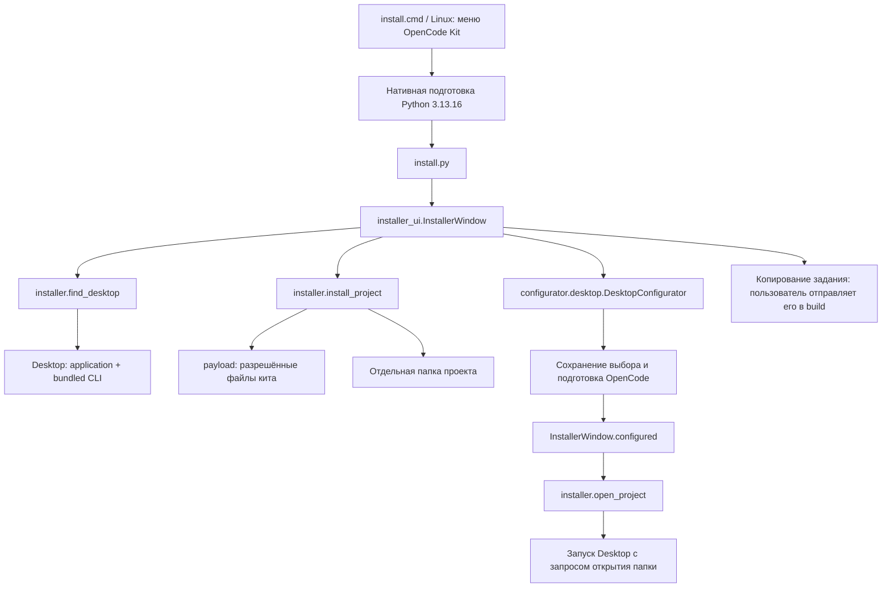
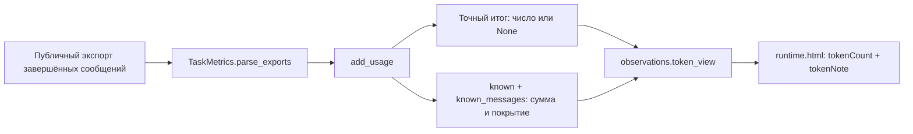

> Материал исходной версии OpenCode. Сохранён для изучения общего кита и истории.
> Для текущей адаптации используй [быстрый старт Pi](../user/PI_QUICKSTART.ru.md)
> и [карту адаптеров](../kit/PI_ADAPTERS.ru.md). Команды OpenCode здесь не являются командами Pi.

# Установщик: карта для разработчика

Сначала прочитайте [инструкцию пользователя](../user/OPENCODE_KIT.ru.md).
Для Ubuntu/Debian/Mint есть [пакет .deb с запуском из меню](../user/LINUX_INSTALL.ru.md).
Установщик готовит отдельную папку и передаёт её существующему конфигуратору.
Он не запускает генерацию приложения и не создаёт задачу разработки.

| Модуль и символ | Ответственность |
|---|---|
| `install.cmd` / `install.sh` | Вход без Python: вызвать нативный bootstrap, затем существующий мастер |
| `kit/runtime/bootstrap.ps1` / `bootstrap.sh` | Прочитать закреплённую версию, проверить личный runtime, скачать и проверить SHA256, подготовить при отсутствии |
| `kit/python.cmd` / `python.sh` | Общий запуск инструментов и Python-приложений через закреплённый runtime |
| `install.py` → `installer_ui.main()` | Создать окно Tk и запустить обработку событий |
| `installer.Desktop` | Неизменяемые пути к GUI-приложению и его встроенному CLI |
| `desktop_from_path()` / `find_desktop()` | Проверить выбранный путь / найти распространённые установки; CLI отдельно не считается Desktop |
| `project_path()` | Проверить полный отдельный путь, не допустить установку в сам исходный кит или через ссылки |
| `payload()` | Собрать разрешённые файлы без ключей, старых журналов и настроек моделей; назначить план в корне нового проекта |
| `install_project()` | Проверить конфликты, создать папки и файлы, дополнить `.gitignore`, записать манифест установки |
| `installed()` | Узнать свою предыдущую установку; повторный мастер не обновляет и не затирает её |
| `InstallerWindow.next_step()` / `poll()` | Копировать в фоновом потоке, передать результат через очередь, обновить окно в основном потоке |
| `configure_models()` | Открыть уже существующий `DesktopConfigurator` для целевой папки |
| `DesktopConfigurator.receive_preparation()` | Получить успех подготовки и вызвать необязательный callback `on_prepared` |
| `configured()` / `open_desktop()` | После успеха разрешить открытие, по флажку отправить запрос Desktop |
| `installer.open_project()` | Закодировать путь в ссылку `opencode://open-project` и запустить приложение; не отправлять задание |
| `copy_prompt()` / `copy_folder()` | Скопировать текст задания / адрес папки в буфер обмена |

**CLI** — консольный интерфейс, GUI — графический. **Callback** — функция,
которую другой компонент вызывает после события: здесь после успешной подготовки.
**Очередь** передаёт результат фонового копирования основному потоку. Это позволяет
окну отвечать на действия, пока читаются файлы. **Манифест** — служебный JSON с
версией формата и SHA256 файлов; SHA256 — отпечаток содержимого. Это не подпись
издателя и не доказательство безопасности скачанного архива.

Устройство подготовки Python, пути и политика обновления описаны отдельно:
[закреплённый runtime](PYTHON_RUNTIME.ru.md).

При конфликте мастер останавливается до копирования. Создание новых файлов использует
режим `xb`: если файл уже появился, он не заменяется. При ошибке удаляются только
созданные этим вызовом неизменённые файлы и пустые папки. Код пользователя не
удаляется рекурсивно. Сохранённые ключи и журналы исходного проекта в новый не копируются.

Ограничение открытия папки отражено в интерфейсе: успешный `Popen` подтверждает
запрос запуска процесса, но не выбор папки Desktop. Поэтому остаются кнопка
копирования пути и инструкция Open Project. Тесты отдельно проверяют эти границы;
они не изображают успешный выбор папки настоящим Desktop.

## Частичные счётчики токенов

Если хотя бы один счётчик неизвестен, точная сумма его колонки остаётся `None`.
`known` хранит сумму доступных значений, `known_messages` — количество сообщений
с этим счётчиком, `missing_counts` — количество без него. Каждая колонка считается
отдельно. В интерфейсе частичная сумма выглядит как `≥ 42`, рядом пояснение о
пропусках. Известный ноль отображается как `0`; отсутствие всех счётчиков — как
«Нет данных». Старые снимки без частичных сумм не позволяют восстановить эти суммы;
журналы при чтении не меняются. Токены reasoning и кэша не прибавляются ко входу/выходу
повторно: категории могут пересекаться.
