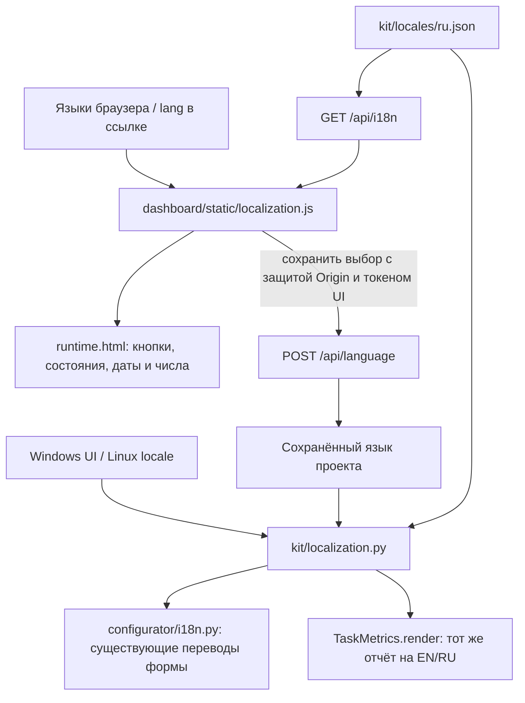

> Материал исходной версии OpenCode. Сохранён для изучения общего кита и истории.
> Для текущей адаптации используй [быстрый старт Pi](../user/PI_QUICKSTART.ru.md)
> и [карту адаптеров](../kit/PI_ADAPTERS.ru.md). Команды OpenCode здесь не являются командами Pi.

# Язык интерфейса: EN/RU

Локализация — перевод системных надписей, а не работа ещё одной модели.
Кит поддерживает English и Русский на Windows и Linux. Название ОС не определяет
язык: важны предпочтения пользователя, язык браузера и язык системного интерфейса.

## Как выбирается язык

| Где | Первый запуск без сохранённого выбора | Ручной выбор |
| --- | --- | --- |
| Дашборд | Первый поддерживаемый язык из `navigator.languages` браузера | Переключатель Language; сохраняется для папки проекта |
| Конфигуратор | Язык интерфейса Windows; на Linux `LC_ALL`, `LC_MESSAGES`, `LANGUAGE`, `LANG`, затем системная локаль | Существующий переключатель Language |
| Отчёт CLI | Сохранённый язык, иначе язык системы | `finish --language en` или `finish --language ru` |

При неподдерживаемом языке используется English. Локали `ru-RU`, `ru_RU.UTF-8`
и `en-US` распознаются. Ручной выбор важнее окружения. Не нужно запускать
`setlocale` и менять глобальное состояние процесса.

Дашборд и конфигуратор используют один локальный файл
`.metrics/.configurator-ui.json`. Он не содержит моделей или ключей и не попадает
в Git. Выбор действует на последующие открытия другого окна; уже открытое окно
конфигуратора не переключается удалённо. Параметр ссылки `lang=en`/`lang=ru`
позволяет открыть конкретное представление без записи глобального предпочтения.

## Что переводится

Кнопки, вкладки, доступные подписи полей, состояния задач, этапы, сведения о
попытках, сообщения управления и известная диагностика. Даты, время и числа в
браузере форматируются через выбранную локаль. Отчёт сохраняет те же счётчики,
неизвестные значения и доказательства тестов на обоих языках.

Названия задач и поручений, пути, код, исходные документы, причины, написанные
пользователем, и публичные сообщения агентов сохраняются в оригинале. Например,
сообщение модели «Нет данных» не превращается в «No data» вместе с кнопками.
Неизвестная техническая диагностика тоже остаётся исходной; это полезно для поиска
ошибки. Для нового системного сообщения следует добавить перевод в каталог.

Переключение языка не запускает/не останавливает модели и не меняет журнал.
Страница отчёта формирует перевод из замороженных данных события `finish` без
повторного экспорта сессий, подсчёта токенов или перезаписи `report.md`.
Произвольный старый текстовый отчёт без таких данных показывается как есть.

## Карта модулей

| Модуль | Основные функции | Назначение |
| --- | --- | --- |
| `kit/localization.py` | `choose_language`, `request_language`, `system_language` | Распознать язык окружения и предпочтения запроса |
| Тот же модуль | `saved_language`, `load_language`, `save_language` | Прочитать/атомарно сохранить только язык |
| Тот же модуль | `text`, `diagnostic`, `task_presentation` | Перевести системный текст, не затронув данные пользователя |
| `kit/dashboard/static/localization.js` | `create`, `text`, `template`, `apply` | Применить словарь к странице, безопасно подставить данные в шаблон |
| `kit/dashboard/runtime.py:Handler` | `language`, `do_GET`, `do_POST` | Выдать словарь, локализованные сведения/отчёт, проверить сохранение языка |
| `kit/configurator/i18n.py:Translator` | `render`, `switch` | Существующие переводы формы, теперь с общим выбором языка |
| `kit/task_metrics.py:TaskMetrics` | `render`, `finish` | Сформировать отчёт на выбранном языке из прежних фактов |

## Как добавить надпись

Английская строка служит ключом, например `Refresh`. В `kit/locales/ru.json`
ей соответствует `Обновить`. Отдельный английский файл не нужен: если русского
перевода нет, выводится английский ключ. У конфигуратора остаётся его существующий
каталог `i18n.RU`, чтобы не переписывать учебные компоненты.

В HTML используется `data-i18n="Refresh"`, в JavaScript — `t('Refresh')`.
Для переменных — шаблон `tr`, который подставляет значения без их перевода.
Данные выводятся через `textContent`, а не исполняются как HTML.
В Python — `localization.text('... {title}', language, title=user_title)`.
Тесты проверяют совпадение плейсхолдеров: это места вида `{title}` или `{0}`,
куда подставляется значение. Переводчик может менять текст вокруг них.

Проверки: `kit.tests.test_localization`, существующие проверки конфигуратора,
HTTP и управления задачами. Для разработки JavaScript нужен Node.js; для самого
дашборда нужен только Python и браузер.

Обновление выполняется в исходном ките. Уже работающий продуктовый эксперимент
не получает новые файлы посреди выполнения автоматически.

Верхний блок дашборда выбирает подпись по `role` последней попытки: `executor`
показывается как «Исполнитель» / «Executor», `bug_fixer` — как «Bug Fixer».
Название модели не определяет роль: одна модель может выполнять разные роли.
При наличии точного ID дочерней сессии её текущая активность и последнее сообщение
выбираются только из этой сессии, чтобы параллельный исполнитель не подменил подпись.
