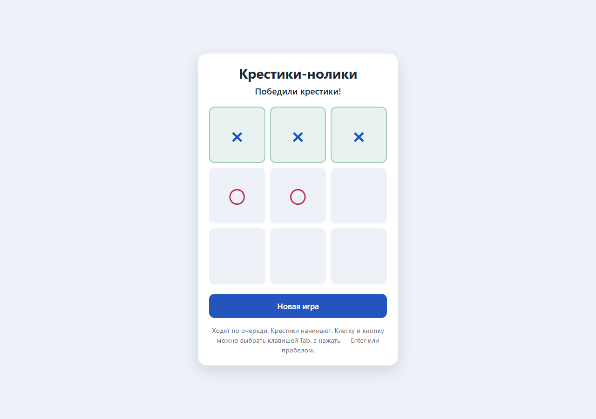

# Чистый прогон системы с Чифом

18 октября 2026 года выполнена отдельная проверка Pi Agent Kit. Игра служит
небольшой задачей для проверки всей цепочки. Критерии результата относятся
к самостоятельной работе Чифа, учёту, приёмке и обработке сбоев системы.

Этот прогон выполнялся предыдущим RPC-входом. Последующее подключение
[штатного интерфейса Pi](PI_NATIVE_TERMINAL.ru.md) имеет отдельные проверки.

## Условия

Создана новая папка `D:\Projects\ActiveProjects\AIProjects\pi-tic-tac-toe-clean-20261018`
штатным установщиком. Поставляемый пример крестиков-ноликов удалён из этой
папки до запуска. Исходники приложения, тесты, архитектура и план не подготавливались
ведущим. Оставлены обычные инструкции AGENTS.md и промпты ролей кита.

Подключения заданы штатным форматом конфигуратора и подготовлены его общей функцией:

| Роль | Подключение | Модель |
| --- | --- | --- |
| Чиф | OpenRouter | deepseek/deepseek-v4.1-flash-1017 |
| Исполнители, два места | OpenRouter | xiaomi/mimo-v2.6-flash |
| Bug Fixer | OpenRouter | deepseek/deepseek-v4.1-flash |

LM Studio не использовалась. Ключ передавался через OPENROUTER_API_KEY.
Во время разработки ведущий только читал состояние и дашборд: не посылал
дополнительных сообщений Чифу, не запускал исполнителей, не редактировал
приложение, не выполнял за Чифа тесты, ревью или интеграцию.

## Вход пользователя

В `start.cmd --prompt` передан один текст с требованиями к игре: поле 3 на 3,
два игрока, первыми крестики, очередь ходов, все победные линии и ничья,
запрет занятых клеток и ходов после завершения, новая игра, русский интерфейс,
работа на компьютере и телефоне, клавиатура, понятные подписи, отсутствие
интернета и внешних сервисов, простой запуск и короткая инструкция.

Дополнительных указаний о делегации или ручных командах в пользовательском ТЗ
не было. Управляемый лаунчер добавил свой обычный контекст задачи и ID сессии.
Дашборд открывает лаунчер до отправки ТЗ. Это поведение управляемого запуска
Pi Kit; прямой запуск команды `pi` такую цепочку сам по себе не обеспечивает.

## Самостоятельная работа Чифа

Задача: `task-20261018-163802-ed19ff`.
Сессия Чифа: `ses_70b90428cf194fd7a04bdad609b8943a`.
Время от start до finish: 18 минут 11 секунд. Консоль завершилась с кодом 0.

| Этап | Факт в журнале |
| --- | --- |
| План и архитектура | Чиф выбрал статическую страницу, написал контракт, скелеты и тесты |
| Публикация | ARCHITECTURE.md и реестр 11 функций доступны дашборду |
| Исходные тесты | Два ожидаемо красных baseline до реализации |
| Делегация | Две изолированные работы game-logic и game-view |
| Параллельность | Промежуток от обеих admission до первого attempt_end — 22.36 секунды |
| Остановка | Обе попытки получили attempt_end с stopped=true |
| Приёмка | Две инспекции, два принятых ревью, две интеграции |
| Общие тесты | Последний полный запуск: 41 тест, без падений, ошибок и пропусков |
| Обзор интерфейса | Чиф записал девять сценариев и одну коррекцию оформления |
| Завершение | Одна запись finish; все три сессии стали idle |

Попытки исполнителей: `b82b5cb5812046cd8722e2017767a016` и
`5426dcbf8aad47d3a147bf4be818fc6c`. Bug Fixer в этой задаче не запускался:
исполнители прошли приёмку без исправлений реализации.

Из восьми рабочих прогонов тестов пять успешны. Два запуска выявили ошибки
тестового кода; ещё один не передал JUnit-путь и получил no_result. Чиф исправил
сравнение объектов из разных VM-контекстов, неверную тестовую последовательность
ходов и команды запуска. Исходные неудачные результаты сохранены.

В инструментах Чифа отмечены 14 ответов с isError, у исполнителей — три.
В их числе ожидаемо красные baseline, неверные пути, ошибки тестов и несовпадения
текста при edit. Эти числа не означают 17 отказов службы Pi: система довела
задачу до finish, а Чиф самостоятельно разобрал ошибки.

Обзор интерфейса выполнялся настоящим headless Chrome. Ходы проверялись через
DOM click, клавиши — через события DevTools. Чиф измерял состояние, геометрию
и стили; в ответе он явно указал, что не видит картинки. Это не ручная визуальная
проверка человеком. Снимки после завершения просмотрены ведущим отдельно.



## Независимая проверка после завершения

Повторный запуск 41 теста прошёл без пропусков. Дополнительная проверка правил,
не использующая написанные Чифом тесты, проверила все 5 478 достижимых позиций,
16 167 допустимых переходов и 33 135 отклонённых ходов. Они покрывают 255 168
завершённых последовательностей: 131 184 победы X, 77 904 победы O и 46 080 ничьих.

Сверка установочного манифеста показала, что Чиф не изменял файлы кита.
Исходники игры совпали с последним успешным тестовым снимком. Эти проверки
проведены после finish и не входят в самостоятельную работу Чифа.

## Системные дефекты и исправления после прогона

### Исполнителю сообщался несуществующий путь тестов

Контроллер всегда указывал workspace/tests, а в новом приложении Чиф выбрал
game/tests. Оба исполнителя получили ENOENT. Теперь find_worker_test_files
в execution_controller.py находит ближайшую существующую папку tests или test
внутри рабочей копии и передаёт точные пути файлов. Если файлов нет, это явно
написано в задании. Добавлены проверки обычного, вложенного и отсутствующего
каталога тестов. Полный набор контроллера: 44 теста, OK.

### Дашборд предлагал запуск самого кита

На итоговом экране старая эвристика выбрала корневой start.sh. Он открывает
консоль Pi Kit, тогда как результат задачи запускается через game/play.cmd.
Теперь delivery.py исключает start.cmd и start.sh из результата Pi-проекта,
в том числе при ошибочной явной регистрации. AGENTS.md требует записать
фактический путь приложения в `.metrics/<task>/progress/result.json`:

```json
{"launcher": "game/play.cmd"}
```

Добавлены три проверки. Закончившаяся копия прогона и её журнал оставлены
как свидетельство первоначального поведения; изменения сделаны в репозитории
шаблона. Для этой игры правильный запуск — game/play.cmd или game/index.html.

### Остановившийся Чиф мог оставить ложный успех консоли

Дополнительная проверка кода обнаружила, что idle всей семьи считался достаточным
основанием вернуть 0 без finish. В живом прогоне этот дефект не проявился:
Чиф записал finish сам. Теперь wait_for_chief различает завершение задачи,
незавершённую работу, защитный STOP и ошибку Pi. Незавершённая задача получает
понятное сообщение с прежним ID сессии для продолжения, а однократный запуск
возвращает ошибку.

Добавлены проверки: остановка без finish, успешное завершение с finish,
ожидание активного исполнителя при idle Чифа, защитный STOP, ошибка процесса,
ошибка публичного ответа и таймаут без прерывания или повторной отправки.
Отдельная проверка действительно завершает собственный тестовый RPC-процесс
и подтверждает сохранение process_exit в реестре. Она не обращается к OpenRouter.
Набор консоли, адаптера и выдачи результата: 48 тестов, OK.

После всех исправлений общий набор: **727 тестов за 86.250 с,
OK, один пропуск**. Пропуск относится к недоступной привилегии Windows
для создания символической ссылки. Строгая оценка кита остаётся skipped/incomplete.
Новые исправления проверены регрессионными тестами; повторный чистый платный
прогон на новой версии после этих исправлений ещё не выполнялся.

## Границы доказательства

Чистый прогон подтвердил самостоятельный основной путь с двумя исполнителями
и восстановление Чифом собственных ошибок команд и тестов. Пауза, смена моделей,
холодное восстановление службы, отмена и удаление проверялись отдельным
[сценарием управления](PI_LIVE_SCENARIO.ru.md), а не нажимались во время этой задачи.
Здесь также не возникали настоящий 429 OpenRouter, обрыв сети и вызов Bug Fixer.

Отказоустойчивость оценивается по сохранности состояния, достоверности статуса,
ограниченным попыткам и подтверждённому восстановлению. Один завершённый пример
не доказывает отсутствие всех будущих отказов. Защитные остановки и неизвестное
подтверждение запроса требуют разбирательства; их нельзя молча обходить новым
ID задачи, повторной отправкой или переключением модели.

Расход Чифа в срезе finish: 314 695 входных и 109 693 выходных токена,
9 136 768 токенов чтения кэша. У двух исполнителей: 36 538 входных,
10 220 выходных и 261 120 токенов чтения кэша. Стоимость неизвестна.
166 вызовов инструментов Чифа показывают значительные накладные расходы
на чтение кода кита и подготовку браузерной проверки. Эффективность требует
отдельных измерений на повторных задачах. Итоговый ответ не входит в срез finish.

## Локальные свидетельства

В репозитории шаблона, внутри исключённой из Git папки
`.metrics/clean-game-20261018/`, сохранены intake.json, console.log, audit.json,
exhaustive-game-check.json, independent-tests.log, final-kit-test.json,
test-path-regression.log, reliability-regressions.log и общий журнал
full-kit-after-reliability-fixes.log. Эти локальные файлы не поставляются другим
пользователям как автоматически воспроизводимый результат.

В проверочном проекте исходный журнал находится в
`.metrics/task-20261018-163802-ed19ff/events.jsonl`, отчёт — рядом в report.md.
Публичные сессии Pi сохраняются в .pi/kit-service/sessions.
