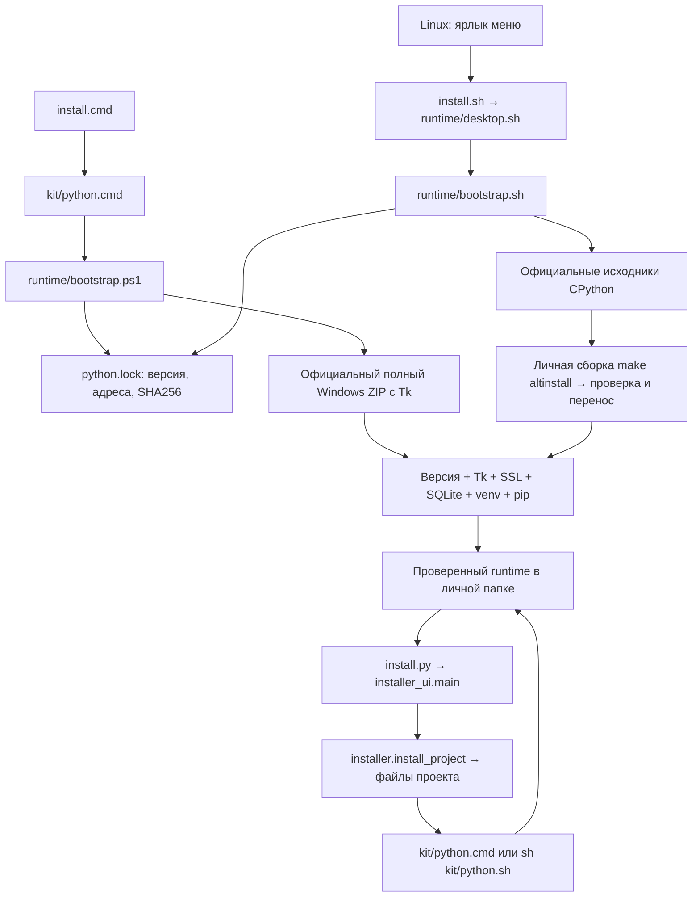

> Материал исходной версии OpenCode. Сохранён для изучения общего кита и истории.
> Для текущей адаптации используй [быстрый старт Pi](../user/PI_QUICKSTART.ru.md)
> и [карту адаптеров](../kit/PI_ADAPTERS.ru.md). Команды OpenCode здесь не являются командами Pi.

# Python без ручной установки

Windows: распаковать кит и открыть **install.cmd**. Ubuntu/Debian/Mint: установить
`.deb` через менеджер программ и открыть **OpenCode Kit** в меню приложений.
Первый запуск требует интернета и свободного места. На Linux подготовка занимает
несколько минут: видимое окно просит дождаться завершения. Затем открывается
обычный мастер папки проекта и моделей. При следующих запусках загрузки нет.

Кит использует **CPython 3.13.16** с Tk, SSL, SQLite, venv и pip. CPython — стандартная
реализация Python; **runtime** — интерпретатор и библиотеки, выполняющие программу.
Версия закреплена до номера исправления: другая версия в PATH не подменяет её.
Проверяется именно личная копия кита, поэтому уже установленный системный Python
может остаться рядом. Скачиваются только официальные файлы с python.org:
[релиз](https://www.python.org/downloads/release/python-31316/),
[Windows-манифест с SHA256](https://www.python.org/ftp/python/3.13.16/windows-3.13.16.json).

## Что с чем связано

| Файл / функция | Для чего нужен |
|---|---|
| `runtime/python.lock` | Единственное место выбора версии, адресов и контрольных сумм. Это данные, не исполняемый shell-код |
| `bootstrap.ps1: Read-Lock` | Проверяет формат, официальные HTTPS-адреса и SHA256 |
| `bootstrap.ps1: Test-Python` / `bootstrap.sh: probe` | Проверяет точную версию и необходимые стандартные библиотеки; окно Tk дополнительно проверяется интеграционными тестами |
| `bootstrap.ps1: Quote-Argument` | Сохраняет кавычки, пробелы и обратные слеши в аргументах Windows |
| `bootstrap.sh: value` | Читает отдельные поля lock-файла без `source` или `eval` |
| `bootstrap.sh: cleanup` | Удаляет только временную папку текущей установки |
| `runtime/desktop.sh` | Показывает подготовку и ошибку в Linux без терминальных команд |
| `kit/linux_package.py: build` | Кладёт bootstrap в `.deb`, назначает зависимости компиляции, Tk и окно прогресса |
| `installer.payload` / `install_project` | Копирует bootstrap в каждый новый проект, сохраняя пользовательские файлы |
| `kit/python.cmd` / `python.sh` | Подготавливает runtime и передаёт ему аргументы; дочерние Python-процессы используют `sys.executable` |

**SHA256** — отпечаток архива. Несовпадение прерывает установку до распаковки.
**Блокировка** не позволяет двум мастерам одновременно устанавливать одну версию.
**Временная папка** хранит загрузку и сборку; в рабочую папку попадает только
проверенный результат. После обрыва установку можно повторить. Повреждённая уже
установленная копия вызывает ошибку с её путём: переименуйте эту папку и повторите.
Bootstrap не удаляет существующую копию и не сбрасывает настройки проекта.

## Где установлен Python

- Windows x64/ARM64: `%LOCALAPPDATA%\OpenCodeKit\runtimes\cpython-3.13.16-windows_x64`
  (для ARM64 окончание `windows_arm64`). Администратор не нужен; реестр не меняется.
- Linux x86_64/aarch64: `$XDG_DATA_HOME/opencode-kit/runtimes/cpython-3.13.16-linux-<архитектура>`;
  обычно `~/.local/share/opencode-kit/runtimes/…`. Сборка не заменяет `/usr/bin/python3`.
- Для тестов или особого размещения `OPENCODE_KIT_RUNTIME_HOME` задаёт полный путь
  к личному кэшу. Символические ссылки и junction в этом пути отклоняются.

PATH меняется только в запущенном процессе и его потомках. Глобальные переменные
Windows, shell-профиль и ссылки системного Python не переписываются. Обёртка также
убирает у своего процесса чужие `PYTHONHOME`, `PYTHONPATH`, `TCL_LIBRARY`, `TK_LIBRARY`.
На уже открытый OpenCode это не влияет: Чиф всегда вызывает явную обёртку проекта.

## Приложения и зависимости

Чиф получает правило делать файлы запуска Python-приложения через эти обёртки.
Например, `start.cmd` вызывает `call "%~dp0kit\python.cmd" "%~dp0app.py"`, а `start.sh`
вызывает `sh "$root/kit/python.sh" "$root/app.py"`, определив `root` по своей папке.
Пользователю не нужно знать команду Python. Установщик не переписывает существующие
файлы запуска приложений; для старого проекта их нужно обновить отдельно.

Сторонние библиотеки приложения устанавливаются в его собственное виртуальное
окружение (`venv`), созданное закреплённым Python. Их версии фиксируются в файле
зависимостей приложения. Общая копия Python принадлежит киту: туда нельзя ставить
библиотеки отдельного приложения. Java, Node и другие языки требуют собственных
средств запуска; этот bootstrap подготавливает именно Python.

## Сборка и обновление

Linux `.deb` устанавливает через apt компилятор, заголовки Tk/SSL/SQLite и другие
зависимости, `curl`, `xz`, `pkg-config`, `util-linux`, `zenity`. Список задаёт
`linux_package.DEPENDENCIES`. Сам bootstrap работает на POSIX shell без Python.
Сборка временно размещается в отдельной приватной папке `/tmp`, потому что `make
altinstall` CPython не везде поддерживает пробелы. Проверенная копия переносится
в личный кэш, а точки запуска pip создаются уже с итоговым адресом. Конфигурация
заголовков и библиотек тоже указывает на постоянный путь: это нужно для установки
расширений Python. Рабочая папка
проекта и путь к кэшу могут содержать пробелы. Для первой сборки нужно место в `/tmp`
и в личной папке; временные исходники после успеха удаляются.
Запуск `sh install.sh` из ZIP тоже возможен, если эти зависимости уже установлены;
для обычного пользователя предназначен `.deb`. macOS пока не имеет автоматической
подготовки: требуется установленный Python с Tk. 32-битные системы не поддерживаются.

Обновление pin — действие сопровождающего: поменять версию и все SHA256 в lock-файле,
проверить Windows и Linux, выпустить новый кит. Автоматического перехода на «последний
Python» нет. Старые проекты сохраняют свой lock; новая версия ставится рядом со старой.
Удаление `.deb` сохраняет проекты и личный runtime; удалить его можно отдельно, когда
его больше не используют проекты. Политика закрепления требует своевременно выпускать
обновления безопасности; молчаливой подмены версии при скачивании нет.
