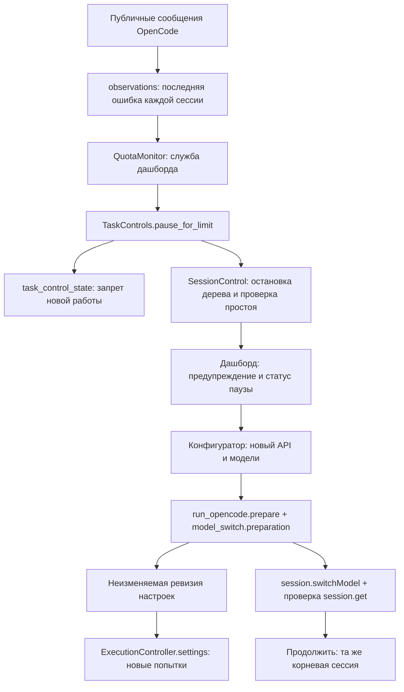

> Материал исходной версии OpenCode. Сохранён для изучения общего кита и истории.
> Для текущей адаптации используй [быстрый старт Pi](../user/PI_QUICKSTART.ru.md)
> и [карту адаптеров](../kit/PI_ADAPTERS.ru.md). Команды OpenCode здесь не являются командами Pi.

# Лимиты провайдера и смена моделей во время задачи

При ошибке квоты или частоты запросов задача приостанавливается. В дашборде
появляется предупреждение с названием модели. Контроллер останавливает Чифа и
его дочерние сессии, проверяет фактический простой и очищает необработанную очередь,
чтобы старые запросы не отправились снова. Код, журналы, принятые задания,
использованные токены и защитные счётчики сохраняются.

**Ошибка 429 не сообщает сама по себе, дневной ли это лимит.** Это может быть
ограничение частоты, общая квота аккаунта или ограничение конкретного провайдера.
Интерфейс не придумывает время сброса и остаток запросов. Ошибка чтения сессий
также не считается ошибкой провайдера и сама по себе не ставит задачу на паузу.

Порядок смены API или модели:

1. Нажмите **Приостановить** и дождитесь статуса **На паузе**. После ошибки квоты пауза включается автоматически.
2. Откройте **Настройки моделей**. Выберите модели и источник для Чифа, исполнителей и Bug Fixer. При необходимости измените адрес API и ключ.
3. Нажмите **Сохранить настройки**, затем **Подготовить OpenCode**. Одного сохранения черновика недостаточно.
4. Дождитесь успешной подготовки. Сервис проверяет доступность выбранных моделей, применяет API-ключи штатным механизмом OpenCode и подтверждает модель существующей сессии.
5. Нажмите **Продолжить**. Продолжение отправляется в прежнюю сессию и задачу. Чиф должен прочитать план, проверить частичные изменения и закончить незавершённое ревью.

Новые попытки используют подготовленную ревизию настроек. Старая попытка сохраняет
свой ID, исходную политику и фактически наблюдавшиеся модели. Никакого автоматического
перехода на платный вариант или другого провайдера после 429 нет. Ошибка API не
считается поводом автоматически вызывать Bug Fixer.

Если подготовка не удалась или модель не подтверждена, задача остаётся на паузе.
Если результат отправки команды продолжения неизвестен, показывается ошибка
управления: нельзя автоматически отправлять второй такой же запрос.

Автопауза работает в сервисе дашборда: закрытие вкладки браузера ей не мешает.
Если сам сервис остановлен, наблюдение Чифа недоступно. Контроллеры изолированных
попыток по-прежнему ограничивают собственные попытки.

## Что с чем связано

| Модуль / функция или класс | Для чего нужен |
|---|---|
| `provider_limits.quota_error()` | Распознаёт публичную ошибку лимита; не сохраняет тело ответа провайдера |
| `dashboard.observations.observations()` | Берёт только последнюю ошибку помощника в каждой сессии; пропускает приватные рассуждения |
| `dashboard.quota_monitor.QuotaMonitor` | Проверяет зарегистрированные задачи в фоне, пока работает сервер дашборда |
| `dashboard.controls.TaskControls.pause_for_limit()` | Проверяет привязку ошибки к задаче, устраняет повторы и вызывает подтверждаемую паузу |
| `task_control_state.blocking_reason()` | Не разрешает метрикам и исполнителям новую работу во время паузы |
| `model_switch.preparation()` | Блокирует конкурентное продолжение на время подготовки, проверяет реальный простой |
| `model_switch.references()` | Вычисляет рабочие ссылки моделей из основной и подготовленной конфигураций |
| `model_switch.revision()` / `verify_revision()` | Читает снимок настроек / проверяет, что перед продолжением они действительно подготовлены |
| `SessionControl.prepare_models()` | Проверяет каталог работающего OpenCode и применяет ключ API через его хранилище учётных данных |
| `SessionControl.switch_model()` | Переключает модель и читает её обратно из прежней сессии |
| `SessionControl.prepare_resume()` / `resume()` | Проверяет подготовку, затем отправляет продолжение с устойчивым ID сообщения |
| `ExecutionController.settings()` | Использует выбранную ревизию для новых попыток, сохраняя первоначальный снимок |

**Ревизия** — отдельный снимок настроек, а не изменение старого снимка. Они лежат в
`.metrics/<task>/model-settings/<revision>.json`. В них есть ссылки моделей, адрес API
и имя переменной ключа, но нет самого ключа. Начальный `execution-settings.json`
не переписывается. Текущая ревизия указана в состоянии управления задачей.

**Устойчивая команда** использует один ID сообщения: неопределённый результат
запроса нельзя лечить слепой повторной отправкой. **Срез после продолжения**
(`quota_after`) отделяет старые ошибки от новых, в том числе если новая 429 пришла
сразу после отправки продолжения. Метрики продолжают суммировать фактические модели
по публичным сообщениям; конфигурация не заменяет доказательство использования.

`SessionControl.call()` передаёт `x-opencode-directory` с кодированной папкой проекта:
общий сервис Desktop может быть запущен из другой папки. Этот заголовок позволяет
каталогу моделей увидеть собственные API именно выбранного проекта. Текущая модель
Чифа берётся из последнего по времени сообщения его сессии; история моделей и расход
до переключения сохраняются отдельно в детализации и «Токенах».
